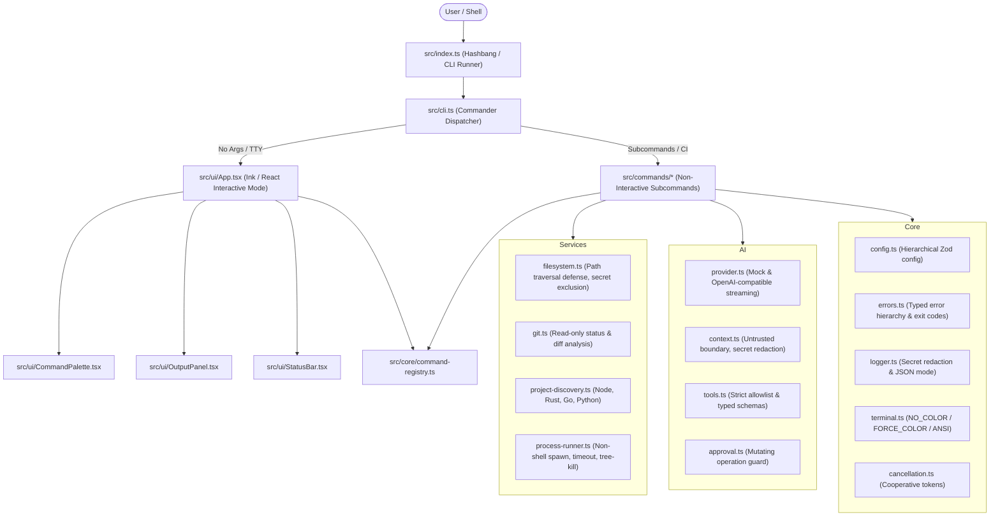

# DevKit Architecture

This document details the architectural decisions, component contracts, and design principles implemented in DevKit.

## Core Architectural Decisions

### 1. Separation of Interaction and Business Logic
The application logic resides in commands (`src/commands/`) and services (`src/services/`). Both the interactive Ink terminal UI (`src/ui/`) and non-interactive Commander CLI (`src/cli.ts`) invoke identical command definitions through `ExecutionContext`. This ensures 100% behavioral equivalence regardless of whether a command was triggered from the interactive palette or a shell script.

### 2. Single Source of Truth for Command Metadata
`src/core/command-registry.ts` registers command names, descriptions, options, arguments, categories, and actions. This eliminates duplicated command documentation and ensures the interactive palette and `--help` output stay perfectly in sync.

### 3. Deep Defense Security Model
- **Filesystem Boundaries**: Path resolution checks canonical paths via `fs.realpathSync` to ensure symbolic links and relative path sequences cannot escape the project root directory.
- **Secret Redaction**: Every string logged, printed, or sent to AI context passes through secret redaction patterns to prevent accidental leaks of API tokens or credentials.
- **Safe Process Spawning**: Shell execution is disabled by default (`shell: false`). Windows batch scripts (`.cmd` / `.bat`) require explicit escaping and path quoting.

### 4. Deterministic Error and Exit Code Mapping
All errors inherit from `DevKitError` and map to stable exit codes (e.g. `ExitCode.FILESYSTEM_ERROR = 3`, `ExitCode.GIT_ERROR = 4`). Script authors can reliably automate workflows based on exit codes.

### 5. Cooperative Cancellation
`CancellationTokenSource` and `CancellationToken` propagate abort signals across asynchronous tasks, process runners, HTTP streaming connections, and child processes, ensuring graceful resource cleanup upon `SIGINT` (Ctrl+C).
